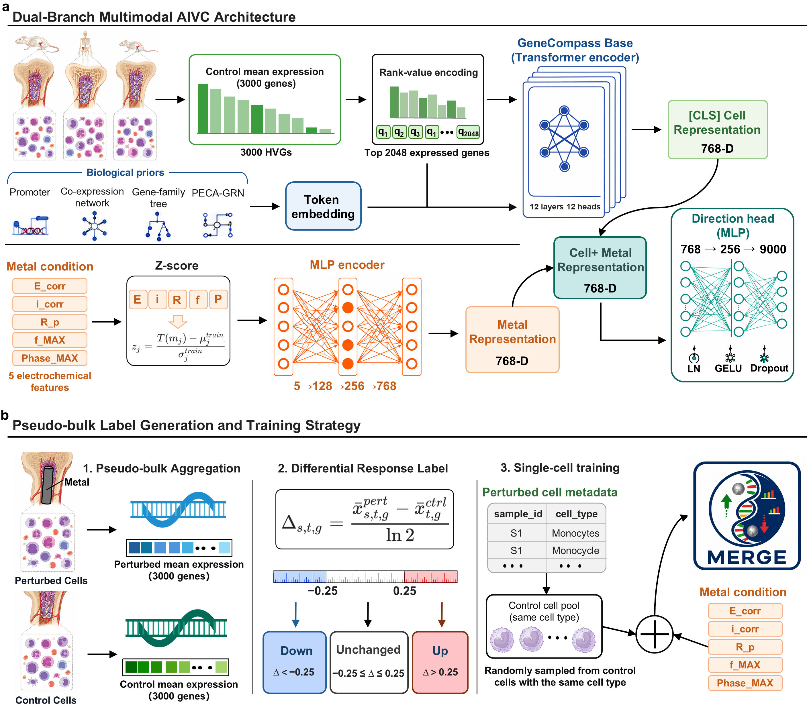

<div align="center">

# MERGE

### Metal Electrochemical-Response Gene Embedding Predicts Transcriptional Responses to Metallic Biomaterials

A multimodal virtual-cell model that links the **measured electrochemistry** of metallic biomaterials to **cell-type-specific transcriptional response directions**.

[](https://www.python.org/)
[](https://pytorch.org/)
[](https://scanpy.readthedocs.io/)
[](LICENSE)
[](https://github.com/Qinyang-Yan)

**English** | [简体中文](README.zh-CN.md)



<sub><b>MERGE overview.</b> A control-cell expression profile is rank–value encoded and processed by pretrained
GeneCompass Base (12 layers, 12 heads, hidden size 768). Five electrochemical descriptors
(<i>E</i><sub>corr</sub>, <i>i</i><sub>corr</sub>, <i>R</i><sub>p</sub>, <i>f</i><sub>MAX</sub>, Phase<sub>MAX</sub>) are
encoded by a dedicated multilayer perceptron. The two 768-dimensional embeddings are fused by element-wise addition
and mapped to <b>Down / Unchanged / Up</b> logits for every gene in the model space. Schematic illustration; not experimental data.</sub>

</div>

---

## 📖 Contents

- [Overview](#-overview)
- [Architecture](#-architecture)
- [Release scope](#-release-scope)
- [Installation](#-installation)
- [GeneCompass assets](#-genecompass-assets)
- [Input data](#-input-data)
- [Configuration](#-configuration)
- [Training & internal evaluation](#-training--internal-evaluation)
- [Predicting new materials](#-predicting-new-materials)
- [External evaluation](#-external-evaluation)
- [Python API](#-python-api)
- [Tests](#-tests)
- [Reproducibility](#-reproducibility)
- [License & citation](#-license--citation)

## ✨ Overview

MERGE predicts, for every gene in a frozen ordered gene space, whether its transcriptional response to a metallic
biomaterial is **Down**, **Unchanged**, or **Up** — using only two inputs:

1. 🧬 a control-cell expression profile from the same annotated cell type;
2. ⚡ five electrochemical descriptors measured for the material.

Perturbed expression is used **only** to construct measured targets. It is never an input to the forward model, so
predictions for an untested material require nothing more than its electrochemical measurements and the original
control reference.

## 🏗️ Architecture

| Branch | Input | Encoder | Output |
|---|---|---|---|
| Cell | normalized log1p control-cell profile | rank–value tokens → **GeneCompass Base** (12 layers, 12 heads, hidden 768) | 768-d embedding |
| Material | 5 electrochemical descriptors | MLP `5 → 128 → 256 → 768` (LayerNorm + GELU + Dropout) | 768-d embedding |
| Fusion | element-wise addition of the two embeddings | | shared representation |
| Prediction head | `768 → 256 → 3G` | three logits per gene (`G` genes; reference `G = 3000`) | Down / Unchanged / Up |

**Response targets.** For perturbation sample *s*, cell type *t*, gene *g*:

```text
Δ(s,t,g) = [ mean_log1p_perturbed(s,t,g) − mean_log1p_control(t,g) ] / ln(2)
```

`Δ < −0.25` → Down, `Δ > 0.25` → Up, otherwise Unchanged. Groups below the minimum cell count receive
`ignore_index` and never enter the loss or metrics.

## 🛡️ Release scope

This repository contains the cleaned model, training, evaluation, and inference source code. Large expression
datasets, GeneCompass assets, trained MERGE checkpoints, experiment logs, and generated figures are intentionally
excluded.

The pipeline enforces the following safeguards:

1. **Split before selection** — biological samples are partitioned before gene-space fitting; validation/test
   perturbation expression never influences HVG selection.
2. **Training-only statistics** — descriptor scaling and class weights are fitted on training data only.
3. **Validation-only model selection** — checkpoints are chosen by validation macro-F1, never by test performance.
4. **Required pretrained encoder** — training and inference explicitly load GeneCompass Base and its required assets.
5. **Strict input validation** — missing mappings, ambiguous input files, absent cell types, and invalid measurements stop the workflow with explicit errors.
6. **Auditable masking** — unmapped and unmeasured genes are padded or masked and recorded in run artifacts.

## 📦 Installation

Python 3.10 is recommended. Install a PyTorch build appropriate for your CUDA/CPU platform from the
[official PyTorch instructions](https://pytorch.org/get-started/locally/) if the default wheel is not suitable.

```bash
git clone https://github.com/Qinyang-Yan/MERGE.git
cd MERGE
conda create -n merge python=3.10 -y
conda activate merge
python -m pip install --upgrade pip
python -m pip install -e .
```

Install GeneCompass from its official source repository. MERGE does not vendor or modify GeneCompass.

```bash
mkdir -p third_party
git clone https://github.com/xCompass-AI/GeneCompass.git third_party/GeneCompass
python -m pip install -r third_party/GeneCompass/requirements.txt
python -m pip install -e third_party/GeneCompass
```

Record the checked-out GeneCompass commit in your experiment records:

```bash
git -C third_party/GeneCompass rev-parse HEAD
```

## 🧬 GeneCompass assets

Download **GeneCompass Base** and its prior-knowledge files from the official
[GeneCompass repository](https://github.com/xCompass-AI/GeneCompass). Arrange them as follows:

```text
assets/
├── GeneCompass_Base/
└── prior_knowledge/
    ├── human_mouse_tokens.pickle
    ├── homologous_hm_token.pickle
    ├── promoter_emb/
    ├── gene_co_express_emb/
    ├── gene_family/
    ├── PECA2vec/
    └── gene_list/
        └── Gene_id_name_dict_human_mouse.pickle
```

Set `MERGE_ASSET_ROOT` if the assets are stored elsewhere:

```bash
export MERGE_ASSET_ROOT=/path/to/assets
```

The wrapper validates all required files before training or inference. Only load checkpoint and pickle assets
obtained from a trusted source.

## 🗂️ Input data

### Electrochemical descriptor CSV

Each row is one replicate measurement with these required columns:

| Column | Meaning | Model transformation |
|---|---|---|
| `sample_id` | Replicate or biological-sample identifier | Identifier only |
| `metal_class` | Material-condition identifier | Aggregation/grouping key |
| `Ecorr` | Corrosion potential | Linear |
| `icorr` | Corrosion current density | Positive; log₁₀ |
| `Rp` | Polarization resistance | Positive; log₁₀ |
| `f_MAX` | Frequency at the phase-angle extremum | Positive; log₁₀ |
| `Phase_MAX` | Phase angle at the extremum, in degrees | Linear; must lie within `[−180, 180]` |

With `feature_matching.mode: metal_class`, replicates are aggregated to one vector per material class: linear fields
use arithmetic means; log-scaled fields use geometric means. With `sample_id` mode, each unique sample row retains
its own descriptor vector.

MERGE preserves the submitted measurements. Validation checks required columns, finite values, positive log-scaled fields, and the phase-angle range.

### Annotated H5AD files

Every H5AD must contain:

- Raw count expression in `X` or `layers['counts']`.
- Cell-type annotations in `obs['cell_type']` or `obs['celltype']`.
- Biological sample identifiers in one of `obs['sample_id']`, `sample`, `Sample`, `orig.ident`, `batch`, or `donor`.
- Unique gene identifiers in `var_names`.

The default configuration expects six training-domain material classes (`Mg`, `Mg_alloy`, `Mg_coat`, `Mo`, `Ti`, and
`Zn`) plus `Ctr`. To use different class names, provide an explicit file manifest in
`configs/data_config.yaml`:

```yaml
h5ad_files:
  Ctr: data/h5ad/Ctr.h5ad
  Mg: data/h5ad/Mg.h5ad
  Mg_alloy: data/h5ad/Mg_alloy.h5ad
  Mg_coat: data/h5ad/Mg_coat.h5ad
  Mo: data/h5ad/Mo.h5ad
  Ti: data/h5ad/Ti.h5ad
  Zn: data/h5ad/Zn.h5ad
```

If `h5ad_files` is null, the loader searches `h5ad_dir` and rejects ambiguous matches. See
[docs/data_format.md](docs/data_format.md) for details.

## ⚙️ Configuration

Default YAML files are in `configs/`. No machine-specific absolute paths are required.

```bash
export MERGE_DATA_ROOT=/path/to/data
export MERGE_OUTPUT_ROOT=/path/to/outputs
export MERGE_ASSET_ROOT=/path/to/assets
```

The default data layout is:

```text
data/
├── h5ad/
└── metal_electrochemical_features.csv
```

Configuration values can also be replaced with dot-list overrides, for example:

```bash
python scripts/train.py \
  --override training.batch_size=8 training.gradient_accumulation_steps=4
```

## 🚀 Training & internal evaluation

Run steps from the repository root after installing both MERGE and GeneCompass.

```bash
# 1. Freeze sample partitions, perform cell QC, and fit the training-only gene space.
python scripts/preprocess_h5ad.py

# 2. Construct pseudo-bulk responses and three-class labels.
python scripts/build_pseudobulk.py

# 3. Fit descriptor scaling on training conditions and train MERGE.
python scripts/train.py

# 4. Evaluate the frozen best checkpoint on held-out samples.
python scripts/evaluate.py

# Optional: evaluate the training-majority reference on the same test samples.
python scripts/evaluate_baseline.py
```

The equivalent shell workflow is:

```bash
bash scripts/run_full_pipeline.sh
```

> [!NOTE]
> Existing processed files, pseudo-bulk directories, and run directories are not deleted by default. Use
> `--overwrite` on the relevant preprocessing, pseudo-bulk, or training command only when replacement is intended.
> Use `python scripts/train.py --resume` to resume from that run's `last.pt`.

Important outputs include:

```text
outputs/
├── reports/merge_split.json
├── preprocessing/
│   ├── gene_index.csv
│   ├── gene_selection_merge.json
│   ├── gene_mapping_merge.json
│   ├── metal_feature_stats_merge.json
│   └── class_weights_merge.json
├── checkpoints/merge/
│   ├── best.pt
│   ├── last.pt
│   └── config.yaml
├── evaluation/merge/
└── logs/
```

## 🔮 Predicting new materials

Prospective prediction requires only the trained artifacts, the original control reference, and a descriptor CSV for
the new materials. Exposed-cell expression is **not** required.

```bash
python scripts/predict.py \
  --metal-features /path/to/new_material_features.csv \
  --n-control-cells-per-type 32
```

The control-cell count is explicit because predictions are aggregated across sampled control cells. The output
`merge_predictions.npz` contains:

- `predictions`: `(material, cell_type, gene)` integer classes;
- `probabilities`: mean class probabilities;
- `vote_counts`: class votes across control-cell inputs;
- `materials`, `cell_types`, `genes`, and `direction_classes` in their stored orders.

`prediction_provenance.json` records the checkpoint, scaler, seed, and sampling count.

## 🌍 External evaluation

When exposed-cell expression is available for evaluation, create a material manifest:

```bash
cp configs/external_config.example.yaml configs/external_config.yaml
```

Edit the example names and paths, then run:

```bash
python scripts/evaluate_external.py \
  --external-config configs/external_config.yaml
```

This workflow performs **no retraining or fine-tuning**. It retains the original gene order, control reference,
descriptor scaler, and direction thresholds. External expression is used only to construct measured targets. Genes
absent from an external object are excluded from its labels and metrics.

Outputs include factual metric tables, group-bootstrap intervals, QC/gene coverage, ground-truth arrays,
predictions, vote counts, and provenance. The code does not generate hard-coded biological conclusions.

## 🐍 Python API

```python
from merge.models import build_model, load_model_checkpoint
from merge.utils.config import load_config

model_config = load_config("configs/model_config.yaml")
gene_names = [...]  # Exact ordered gene space used during training
model = build_model(model_config, n_genes=len(gene_names), gene_names=gene_names)
load_model_checkpoint(model, "outputs/checkpoints/merge/best.pt")
model.eval()
```

`load_model_checkpoint` uses strict tensor loading. A partial or incompatible checkpoint raises an error.

## ✅ Tests

The unit and integration suite uses small in-memory arrays and does not download GeneCompass or experimental data.

```bash
python -m pip install -e '.[dev]'
python -m pytest -q
```

The tests cover split isolation, training-only gene fitting, descriptor validation/scaling, strict sample alignment,
model assembly, masked loss, three-class metrics, Top-K evaluation, external gene masking, seeded control sampling,
and group-level inference.

## 🔁 Reproducibility

- Random seeds cover Python, NumPy, PyTorch, CUDA, and DataLoader workers. Bitwise reproducibility requires identical hardware, drivers, and library versions.
- A run's split, gene index, scaler, class weights, resolved configuration, and checkpoint belong together. Keep these artifacts within the same run.
- The release protocol fits HVGs after sample splitting. Generate each checkpoint and its evaluation artifacts from the same frozen split and ordered gene index.
- Report the exact GeneCompass commit, asset versions, package versions, seed, and command-line overrides with
  scientific results.

See [docs/reproducibility.md](docs/reproducibility.md) and [docs/model.md](docs/model.md).

## 📄 License & citation

**Code author:** [Qinyang Yan](https://github.com/Qinyang-Yan)

MERGE source code is released under the [MIT License](LICENSE). GeneCompass and its pretrained assets remain
subject to their separate terms.

If you use MERGE in your research, please cite the associated manuscript:

> MERGE: Metal Electrochemical-Response Gene Embedding Predicts Transcriptional Responses to Metallic Biomaterials.

Please also cite
[GeneCompass](https://doi.org/10.1038/s41422-024-01034-y) and follow its separate license and asset terms.

<div align="center">
<sub>Built with 🧬 single-cell transcriptomics and ⚡ corrosion electrochemistry</sub>
</div>
