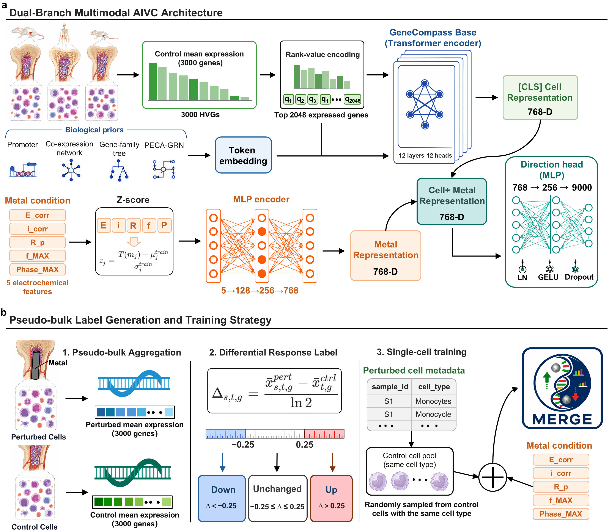

<div align="center">

# MERGE

### Metal Electrochemical-Response Gene Embedding：预测金属生物材料引起的转录响应

一个多模态虚拟细胞模型，将金属生物材料的**实测电化学性质**与**细胞类型特异的转录响应方向**联系起来。

[](https://www.python.org/)
[](https://pytorch.org/)
[](https://scanpy.readthedocs.io/)
[](https://github.com/Qinyang-Yan/MERGE/actions/workflows/tests.yml)
[](LICENSE)
[](https://github.com/Qinyang-Yan)

[English](README.md) | **简体中文**



<sub><b>MERGE 总览。</b>对照细胞的表达谱经秩–值编码后由预训练的 GeneCompass Base 处理
（12 层 Transformer、12 个注意力头、隐藏维度 768）；五个电化学描述符
（<i>E</i><sub>corr</sub>、<i>i</i><sub>corr</sub>、<i>R</i><sub>p</sub>、<i>f</i><sub>MAX</sub>、Phase<sub>MAX</sub>）
由专用的多层感知机编码。两路 768 维嵌入逐元素相加融合，并为模型基因空间中的每个基因输出
<b>下调（Down）/ 不变（Unchanged）/ 上调（Up）</b>三类 logits。本图为模型示意图，非实验数据图。</sub>

</div>

---

## 📖 目录

- [模型简介](#-模型简介)
- [模型架构](#-模型架构)
- [开源范围](#-开源范围)
- [安装](#-安装)
- [GeneCompass 资产](#-genecompass-资产)
- [输入数据](#-输入数据)
- [配置](#-配置)
- [训练与内部评估](#-训练与内部评估)
- [预测新材料](#-预测新材料)
- [外部评估](#-外部评估)
- [Python API](#-python-api)
- [测试](#-测试)
- [可复现性](#-可复现性)
- [许可证与引用](#-许可证与引用)

## ✨ 模型简介

MERGE 在一个固定顺序的基因空间中，为每个基因预测其对金属生物材料的转录响应方向：
**下调（Down）**、**不变（Unchanged）** 或 **上调（Up）** —— 仅使用两个输入：

1. 🧬 来自同一注释细胞类型的对照细胞表达谱；
2. ⚡ 该材料实测的五个电化学描述符。

扰动细胞的表达**仅**用于构建实测标签（targets），从不作为前向模型的输入。因此，预测一种未测试的材料
只需要它的电化学测量值和原始对照参考，无需任何新的转录组数据。

## 🏗️ 模型架构

| 分支 | 输入 | 编码器 | 输出 |
|---|---|---|---|
| 细胞分支 | 归一化 log1p 对照细胞表达谱 | 秩–值 token → **GeneCompass Base**（12 层、12 头、隐藏维度 768） | 768 维嵌入 |
| 材料分支 | 5 个电化学描述符 | MLP `5 → 128 → 256 → 768`（LayerNorm + GELU + Dropout） | 768 维嵌入 |
| 融合 | 两个嵌入逐元素相加 | | 共享表示 |
| 预测头 | `768 → 256 → 3G` | 每个基因三个 logits（`G` 个基因；参考配置 `G = 3000`） | 下调 / 不变 / 上调 |

**响应标签构建。** 对扰动样本 *s*、细胞类型 *t*、基因 *g*：

```text
Δ(s,t,g) = [ mean_log1p_perturbed(s,t,g) − mean_log1p_control(t,g) ] / ln(2)
```

`Δ < −0.25` → 下调，`Δ > 0.25` → 上调，其余为不变。低于最小细胞数门槛的组标记为
`ignore_index`，不进入损失计算和指标统计。

## 🛡️ 开源范围

本仓库包含整理后的模型、训练、评估和推理源码。大规模表达数据、GeneCompass 资产、训练好的 MERGE
checkpoint、实验日志和生成的图表均不包含在内。

代码流程内置以下保障：

1. **先划分后选基因** —— 在基因空间拟合之前先完成生物学样本划分；验证/测试的扰动表达从不参与
   HVG 选择。
2. **仅用训练数据拟合统计量** —— 描述符标准化和类别权重仅由训练数据拟合。
3. **仅按验证集选模型** —— checkpoint 依据验证集 macro-F1 选择，绝不依据测试集表现。
4. **必需的预训练编码器** —— 训练和推理均显式加载 GeneCompass Base 及其配套资产。
5. **严格输入校验** —— 对缺失映射、歧义输入文件、缺失细胞类型和无效测量值给出明确错误并停止流程。
6. **可审计的掩码** —— 未映射和未测得的基因被显式填充或掩码，并记录在 run 产物中。

## 📦 安装

推荐使用 Python 3.10。如果默认 wheel 不合适，请按
[PyTorch 官方指南](https://pytorch.org/get-started/locally/)安装与你的 CUDA/CPU 平台匹配的 PyTorch 版本。

```bash
git clone https://github.com/Qinyang-Yan/MERGE.git
cd MERGE
conda create -n merge python=3.10 -y
conda activate merge
python -m pip install --upgrade pip
python -m pip install -e .
```

从 GeneCompass 官方源码仓库安装 GeneCompass。MERGE 不内置、也不修改 GeneCompass。

```bash
mkdir -p third_party
git clone https://github.com/xCompass-AI/GeneCompass.git third_party/GeneCompass
python -m pip install -r third_party/GeneCompass/requirements.txt
python -m pip install -e third_party/GeneCompass
```

在实验记录中登记所用的 GeneCompass 提交版本：

```bash
git -C third_party/GeneCompass rev-parse HEAD
```

## 🧬 GeneCompass 资产

从 [GeneCompass 官方仓库](https://github.com/xCompass-AI/GeneCompass)下载 **GeneCompass Base** 及其
先验知识文件，按如下结构放置：

```text
assets/
├── GeneCompass_Base/
└── prior_knowledge/
    ├── human_mouse_tokens.pickle
    ├── homologous_hm_token.pickle
    ├── promoter_emb/
    ├── gene_co_express_emb/
    ├── gene_family/
    ├── PECA2vec/
    └── gene_list/
        └── Gene_id_name_dict_human_mouse.pickle
```

如果资产存放在其他位置，请设置 `MERGE_ASSET_ROOT`：

```bash
export MERGE_ASSET_ROOT=/path/to/assets
```

加载器会在训练或推理前校验所有必需文件。只应从可信来源获取 checkpoint 和 pickle 资产。

## 🗂️ 输入数据

### 电化学描述符 CSV

每一行是一次重复测量的数据，必须包含以下列：

| 列名 | 含义 | 模型变换 |
|---|---|---|
| `sample_id` | 重复测量或生物学样本标识 | 仅作标识 |
| `metal_class` | 材料条件标识 | 聚合/分组键 |
| `Ecorr` | 腐蚀电位 | 线性值 |
| `icorr` | 腐蚀电流密度 | 正数；log₁₀ |
| `Rp` | 极化电阻 | 正数；log₁₀ |
| `f_MAX` | 相位角极值处的频率 | 正数；log₁₀ |
| `Phase_MAX` | 极值处相位角（度） | 线性值；必须位于 `[−180, 180]` |

`feature_matching.mode: metal_class` 时，重复测量聚合为每种材料一个向量：线性字段取算术均值，
log 刻度字段取几何均值。`sample_id` 模式时，每个唯一的样本行保留自己的描述符向量。

MERGE 保留用户提交的原始测量值。校验内容包括必需列、有限数值、log 刻度字段的正值要求和相位角范围。

### 注释完整的 H5AD 文件

每个 H5AD 必须包含：

- `X` 或 `layers['counts']` 中的原始计数表达矩阵。
- `obs['cell_type']` 或 `obs['celltype']` 中的细胞类型注释。
- `obs['sample_id']`、`sample`、`Sample`、`orig.ident`、`batch` 或 `donor` 之一的生物学样本标识。
- `var_names` 中唯一的基因标识。

默认配置使用六个训练域材料类别（`Mg`、`Mg_alloy`、`Mg_coat`、`Mo`、`Ti`、`Zn`）加上 `Ctr`。
你可以修改类别名，并在 `configs/data_config.yaml` 中提供显式文件清单：

```yaml
h5ad_files:
  Ctr: data/h5ad/Ctr.h5ad
  Mg: data/h5ad/Mg.h5ad
  Mg_alloy: data/h5ad/Mg_alloy.h5ad
  Mg_coat: data/h5ad/Mg_coat.h5ad
  Mo: data/h5ad/Mo.h5ad
  Ti: data/h5ad/Ti.h5ad
  Zn: data/h5ad/Zn.h5ad
```

若 `h5ad_files` 为空，加载器会在 `h5ad_dir` 中搜索，并拒绝有歧义的匹配。详见
[docs/data_format.md](docs/data_format.md)。

## ⚙️ 配置

默认 YAML 文件在 `configs/` 中，不需要任何机器特定的绝对路径。

```bash
export MERGE_DATA_ROOT=/path/to/data
export MERGE_OUTPUT_ROOT=/path/to/outputs
export MERGE_ASSET_ROOT=/path/to/assets
```

默认数据目录结构：

```text
data/
├── h5ad/
└── metal_electrochemical_features.csv
```

配置项也可以用 dot-list 覆盖，例如：

```bash
python scripts/train.py \
  --override training.batch_size=8 training.gradient_accumulation_steps=4
```

## 🚀 训练与内部评估

安装好 MERGE 和 GeneCompass 后，在仓库根目录按顺序执行：

```bash
# 1. 冻结样本划分、执行细胞质控、仅用训练数据拟合基因空间。
python scripts/preprocess_h5ad.py

# 2. 构建 pseudo-bulk 响应和三分类标签。
python scripts/build_pseudobulk.py

# 3. 用训练材料拟合描述符标准化参数并训练 MERGE。
python scripts/train.py

# 4. 在留出样本上评估冻结的最优 checkpoint。
python scripts/evaluate.py

# 可选：在相同的测试样本上评估训练多数类参考基线。
python scripts/evaluate_baseline.py
```

等价的 shell 一键流程：

```bash
bash scripts/run_full_pipeline.sh
```

> [!NOTE]
> 已存在的处理文件、pseudo-bulk 目录和 run 目录默认不会被删除。仅在确实需要替换时，才对相应的
> 预处理、pseudo-bulk 或训练命令加 `--overwrite`。使用 `python scripts/train.py --resume` 可从该
> run 的 `last.pt` 恢复训练。

主要输出包括：

```text
outputs/
├── reports/merge_split.json
├── preprocessing/
│   ├── gene_index.csv
│   ├── gene_selection_merge.json
│   ├── gene_mapping_merge.json
│   ├── metal_feature_stats_merge.json
│   └── class_weights_merge.json
├── checkpoints/merge/
│   ├── best.pt
│   ├── last.pt
│   └── config.yaml
├── evaluation/merge/
└── logs/
```

## 🔮 预测新材料

前瞻性预测只需要训练产物、原始对照参考和新材料的描述符 CSV，**不需要**暴露细胞的表达数据。

```bash
python scripts/predict.py \
  --metal-features /path/to/new_material_features.csv \
  --n-control-cells-per-type 32
```

对照细胞数量是显式参数，因为预测会在多个采样的对照细胞输入上聚合。输出文件
`merge_predictions.npz` 包含：

- `predictions`：`(材料, 细胞类型, 基因)` 整数类别；
- `probabilities`：平均类别概率；
- `vote_counts`：跨对照细胞输入的类别投票数；
- `materials`、`cell_types`、`genes`、`direction_classes` 及其存储顺序。

`prediction_provenance.json` 记录 checkpoint、标准化参数、随机种子和采样数量等溯源信息。

## 🌍 外部评估

当有暴露细胞的表达数据可用于评估时，先创建材料清单：

```bash
cp configs/external_config.example.yaml configs/external_config.yaml
```

修改示例中的名称和路径，然后运行：

```bash
python scripts/evaluate_external.py \
  --external-config configs/external_config.yaml
```

该流程**不进行任何重训练或微调**，完整保留原始基因顺序、对照参考、描述符标准化参数和方向阈值。
外部表达仅用于构建实测标签。外部数据中缺失的基因会从其标签和指标中排除。

输出包括事实性指标表、组级 bootstrap 置信区间、QC/基因覆盖度、真实标签数组、预测结果、投票数和
溯源信息。代码不会输出硬编码的生物学结论。

## 🐍 Python API

```python
from merge.models import build_model, load_model_checkpoint
from merge.utils.config import load_config

model_config = load_config("configs/model_config.yaml")
gene_names = [...]  # 训练时使用的确切有序基因空间
model = build_model(model_config, n_genes=len(gene_names), gene_names=gene_names)
load_model_checkpoint(model, "outputs/checkpoints/merge/best.pt")
model.eval()
```

`load_model_checkpoint` 使用严格张量加载。不完整或不兼容的 checkpoint 会直接报错。

## ✅ 测试

单元与集成测试使用小型内存数组，不下载 GeneCompass 或实验数据。

```bash
python -m pip install -e '.[dev]'
python -m pytest -q
```

测试覆盖：划分隔离、仅训练数据选基因、描述符校验与标准化、严格样本对齐、模型组装、掩码损失、
三分类指标、Top-K 评估、外部基因掩码、种子化对照采样和组级推理。

## 🔁 可复现性

- 随机种子覆盖 Python、NumPy、PyTorch、CUDA 和 DataLoader worker。逐位复现要求使用相同的硬件、驱动和库版本。
- 一个 run 的划分、基因索引、标准化参数、类别权重、解析后的配置和 checkpoint 相互绑定，应保存在同一 run 中。
- 发布版流程在样本划分之后拟合 HVG。每个 checkpoint 及其评估产物均由同一份冻结划分和有序基因索引生成。
- 报告科学结果时，请同时给出 GeneCompass 的确切 commit、资产版本、依赖包版本、随机种子和命令行
  覆盖参数。

详见 [docs/reproducibility.md](docs/reproducibility.md) 与 [docs/model.md](docs/model.md)。

## 📄 许可证与引用

**代码作者：**[Qinyang Yan](https://github.com/Qinyang-Yan)

MERGE 源码基于 [MIT 许可证](LICENSE)开源。GeneCompass 及其预训练资产仍受其各自条款约束。

如果在研究中使用 MERGE，请引用相关论文：

> MERGE: Metal Electrochemical-Response Gene Embedding Predicts Transcriptional Responses to Metallic Biomaterials.

同时请引用 [GeneCompass](https://doi.org/10.1038/s41422-024-01034-y)，并遵循其独立的许可和资产条款。

<div align="center">
<sub>由 🧬 单细胞转录组学与 ⚡ 腐蚀电化学共同驱动</sub>
</div>
